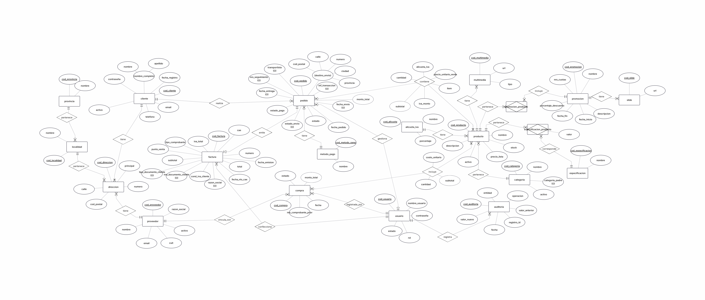

# proyecto-bd1-equipo_37

El objetivo central del proyecto es diseñar, normalizar e implementar una base de datos relacional que soporte el ciclo completo de operaciones de venta, garantizando la integridad referencial, la consistencia y la no redundancia de la información.

**Materia:** Bases de Datos I, UNNE (2026) · **Equipo:** 37

**Integrantes:** Enzo Mauricio Antonio Benitez, Lisandro Lopez, Mercedes Fernandez

## El caso: SmartHome Store

SmartHome Store es una empresa minorista de electrodomésticos y productos electrónicos que vende por teléfono y redes sociales, y controla pedidos y stock en planillas de cálculo. Con el crecimiento de las ventas aparecieron errores, como vender productos sin stock, así que decidió migrar a una tienda online.

La base de datos cubre clientes, catálogo de productos, promociones, compras a proveedores, pedidos, pagos, facturación, usuarios internos y auditoría de operaciones sensibles. No cubre la pasarela de pago por dentro, la logística del transporte, la venta en local ni las devoluciones. El detalle está en [alcance.md](docs/etapa-01/alcance.md).

## Estado del proyecto

| Etapa | Contenido | Estado | Documentación |
|---|---|---|---|
| I. Requerimientos | Caso, alcance y 30 reglas de negocio | Completa | [docs/etapa-01](docs/etapa-01/) |
| II. Modelado | DER, modelo relacional, normalización y decisiones de diseño | Completa | [docs/etapa-02](docs/etapa-02/) |
| III. Implementación | 22 tablas, restricciones y datos de prueba | Completa | [docs/etapa-03](docs/etapa-03/) |
| IV. Consultas | 15 casos de uso: comprobante, reporte agregado y consultas avanzadas | Completa | [docs/etapa-04](docs/etapa-04/) |
| V. Temas técnicos | Procedimientos y funciones, transacciones, triggers, seguridad e índices | Completa | [docs/etapa-05](docs/etapa-05/) |

En la Etapa V, los cinco temas tienen scripts, documentación y conclusiones. Parte de los resultados se verificó con la salida de `sqlcmd` y todavía no tiene captura de SSMS.

## Cómo ejecutarlo

**Requisitos:** SQL Server Express y SSMS o `sqlcmd`. Los scripts crean la base `smarthome_store`; si ya existe, hay que borrarla antes.

Ejecutar en este orden:

| # | Script | Qué hace |
|---|---|---|
| 1 | [sql/ddl/crear_bd.sql](sql/ddl/crear_bd.sql) | Crea la base y las tablas |
| 2 | [sql/dml/cargar_datos.sql](sql/dml/cargar_datos.sql) | Carga los datos de prueba |
| 3 | [sql/consultas/](sql/consultas/) | Consultas de la Etapa IV, en cualquier orden |
| 4 | [procedimientos_funciones/scripts.sql](docs/etapa-05/procedimientos_funciones/scripts.sql) | Crea las funciones y el procedimiento de venta, y corre sus pruebas |
| 5 | [transacciones/scripts.sql](docs/etapa-05/transacciones/scripts.sql) | Crea la cancelación de pedidos y la confirmación de compras, y corre las pruebas de transacciones (usa el paso 4) |
| 6 | [triggers_auditoria/scripts.sql](docs/etapa-05/triggers_auditoria/scripts.sql) | Crea los triggers de auditoría y corre sus pruebas (usa el paso 4) |
| 7 | [seguridad/01_permisos_estado_pedido.sql](sql/tecnico/seguridad/01_permisos_estado_pedido.sql) | Crea el rol de la aplicación, le impide cambiar `estado` sin los procedimientos y corre sus pruebas (usa los pasos 4 y 5) |
| 8 | [seguridad/02_usuarios_y_roles.sql](sql/tecnico/seguridad/02_usuarios_y_roles.sql) | Crea usuarios y un rol de demostración y corre sus pruebas (usa el paso 4). Se limpia con `99_limpieza_usuarios.sql` |

Ejemplo con `sqlcmd`, desde la raíz del repositorio:

```
sqlcmd -S .\SQLEXPRESS -E -C -f 65001 -i sql\ddl\crear_bd.sql
sqlcmd -S .\SQLEXPRESS -E -C -f 65001 -i sql\dml\cargar_datos.sql
```

`-f 65001` hace que los acentos se lean bien. Los índices filtrados de `direccion` exigen `QUOTED_IDENTIFIER ON`: estos dos scripts ya lo activan, pero otro script que modifique esa tabla con `sqlcmd` necesita la opción `-I`. Los resultados de las pruebas de auditoría suponen una base recién cargada: si se ejecuta el paso 5 con los triggers ya creados, quedan filas de más en `auditoria`.

**Índices:** los scripts de [sql/tecnico/indices/](sql/tecnico/indices/) se ejecutan en orden (01 a 03) sobre la base ya cargada. Crean una tabla auxiliar de un millón de filas y la eliminan al final. `02_pruebas_indices.sql` vacía la memoria de datos de todo el servidor, así que conviene usarlo solo en un equipo de pruebas.

## Por qué 22 tablas

Cada tabla responde a una regla de negocio o a la normalización, dentro del alcance definido. La justificación completa está en la [decisión 16](docs/etapa-02/decisiones-diseno.md).

## Modelo de datos



El detalle de las tablas y el diagrama relacional están en [modelo-relacional.md](docs/etapa-02/modelo-relacional.md).

| Área | Tablas |
|---|---|
| Clientes y ubicación | `cliente`, `direccion`, `localidad`, `provincia` |
| Catálogo | `producto`, `categoria`, `alicuota_iva`, `especificacion`, `especificacion_producto`, `multimedia` |
| Promociones | `promocion`, `promocion_producto`, `slide` |
| Ventas | `pedido`, `detalle_pedido`, `metodo_pago`, `factura` |
| Compras | `compra`, `detalle_compra`, `proveedor` (sus direcciones también están en `direccion`) |
| Administración | `usuario`, `auditoria` |

## Estructura del repositorio

```
docs/
  etapa-01/   Caso, alcance y reglas de negocio
  etapa-02/   DER, modelo relacional, normalización y decisiones
  etapa-03/   Implementación, restricciones y pruebas de validación
  etapa-04/   Casos de uso y explicación de cada consulta
  etapa-05/   Por tema: investigacion.md, scripts.sql y evidencias/
sql/
  ddl/        Creación de la base
  dml/        Datos de prueba
  consultas/  Consultas de la Etapa IV
  tecnico/    Scripts adicionales de la Etapa V
```

`modelos/der/` está vacía: el DER está en `docs/etapa-02/DER/`.
